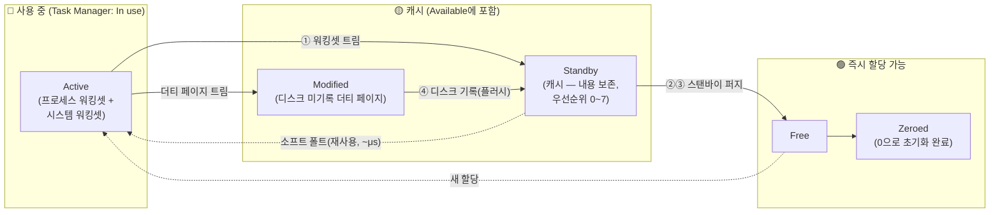
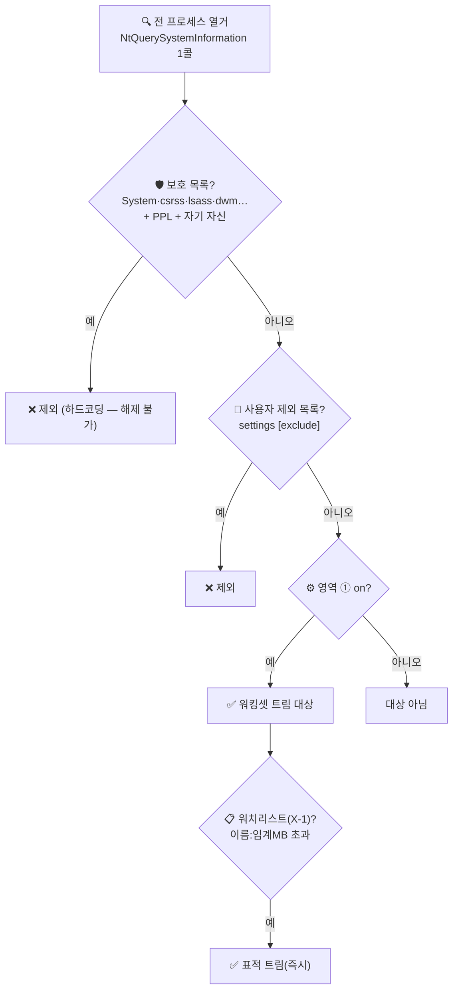
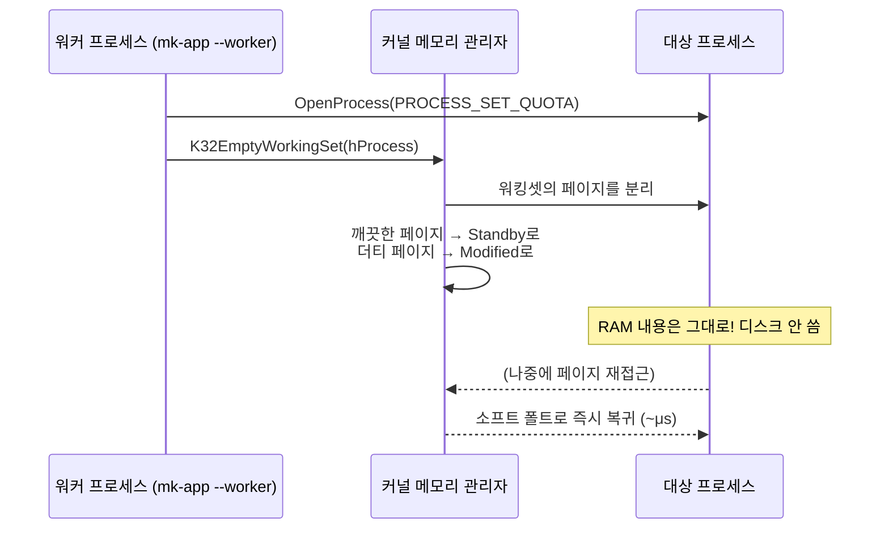

# 19 · 메모리 측정 · 정리 대상 선정 · 회수 방식 — 기술 해설

> [ADR-0002(07)](07-adr-0002-memory-reclaim.md)의 결정을 **원리 수준에서 풀어 쓴 해설서**. 구현 판단이 아니라 이해가 목적.
> 다이어그램은 mermaid(GitHub/VS Code 렌더), 수식은 코드 표기. 결정 변경은 여기가 아니라 ADR에서.

---

## 1. 🧱 기초 — Windows 물리 메모리 페이지의 5가지 상태

Windows는 물리 RAM을 4KB 페이지 단위로 관리하며, 각 페이지는 아래 상태 중 하나에 있다.
**"메모리 정리"란 페이지를 왼쪽(사용 중)에서 오른쪽(재사용 가능)으로 옮기는 일**이다.



- **Standby = 버려진 게 아니라 캐시**다. 파일 캐시·트림된 페이지가 내용을 유지한 채 대기하며, 프로세스가 다시 만지면 디스크 없이 **소프트 폴트**로 즉시 복귀한다.
- 작업 관리자 매핑: `사용 중 = Active+Modified 일부` · `사용 가능(Available) = Standby+Free+Zeroed`.

---

## 2. 📏 측정 기준 — 무엇을 "여유"라 부르는가

### 2-1. 시스템 전체 (트레이 아이콘·자동 정리 트리거의 기준)

측정 API: **`GlobalMemoryStatusEx`** (5초 폴링 — 콜 1회, 비용 ~수 μs)

```
사용률(%) = round( (ullTotalPhys − ullAvailPhys) / ullTotalPhys × 100 )

ullAvailPhys = Standby + Free + Zeroed     ← "Available"의 정의
```

⚠️ **함정**: `Available`에는 Standby(캐시)가 이미 포함된다. 즉 "여유가 없다"는 상태는
Free가 아니라 **Active(워킹셋)가 크다**는 뜻이고, 그래서 정리의 1순위가 워킹셋 트림(①)이다.

### 2-2. 프로세스별 (Top 5·트리 뷰·워치리스트의 기준)

| 지표 | 의미 | 본 프로젝트 용도 |
| --- | --- | --- |
| **Private Working Set** 🎯 | RAM에 있는 **그 프로세스 전용** 페이지 | **Top 5 정렬 기본**(작업 관리자 "메모리" 열과 동일 기준) |
| Working Set (전체) | 전용 + 공유(DLL) 페이지 — 공유분은 중복 계상됨 | 예산 게이트 실측(DR-8), 참고 열 |
| Private Bytes (Commit) | RAM+페이지파일에 약속된 전용 커밋 | 누수 진단용 참고 |

- 수집: `NtQuerySystemInformation(SystemProcessInformation)` **1콜**의 각 항목에
  `WorkingSetSize`·`WorkingSetPrivateSize`가 함께 들어 있다 → 프로세스별 `OpenProcess` 불필요([07 §2](07-adr-0002-memory-reclaim.md)).

### 2-3. "유휴(idle)" 판정 — 자기 자신의 예산 측정(DR-8)

```
유휴 RSS = 실행 후 아무 조작 없이 60초 방치한 시점의 WorkingSet64
           (M0-1 실측: 11.14MB → 자기 트림 → 1.56MB)
```

---

## 3. 🎯 정리 대상 선정 — 무엇을 건드리고, 무엇을 절대 건드리지 않는가

### 3-1. 선정 파이프라인 (매 정리 실행마다)



- 보호 판정은 **열거 단계**에서 플래그를 붙이고, 종료·트림 함수는 그 플래그를 시그니처로 강제받는다 — 우회 경로 자체가 없다([15 §4](15-dev-methodology.md)).

### 3-2. 영역별 효과 × 부작용 매트릭스

| 영역 | 무엇이 늘어나나 | 대가(부작용) | 기본값 | 위험도 |
| --- | --- | --- | --- | --- |
| ① 프로세스 워킹셋 트림 | Available↑ (Active→Standby) | 재사용 시 소프트 폴트(~μs) | ✅ on | 🟢 낮음 |
| ② 우선순위 0 스탠바이 퍼지 | Free↑ | 저가치 캐시만 소실 | ✅ on | 🟢 낮음 |
| ③ 전체 스탠바이 퍼지 | Free↑↑ | **파일 캐시 전멸** → 재적재 = 디스크 I/O(~ms) | ☐ off | 🟠 중간 |
| ④ 수정 페이지 플러시 | Standby↑ | 즉시 디스크 쓰기 폭증 | ☐ off | 🟠 중간 |
| ⑤ 시스템 워킹셋 | Available↑ | 시스템 캐시 재적재 비용 | ☐ off | 🟠 중간 |
| ⑥ 페이지 결합 | 실효 RAM↑ | CPU 소모·효과 완만 | ☐ off | 🟡 낮음~중간 |

> 💡 **왜 스탠바이 우선순위가 중요한가**: Standby는 0(최저가치)~7(최고가치) 8단계 리스트로 나뉜다.
> 우선순위 0은 "곧 버려질 캐시"라 퍼지해도 손해가 거의 없고(②), 전체 퍼지(③)는 방금 읽은 파일 캐시까지 버려
> **정리 직후 시스템이 잠깐 더 느려지는** 메모리 클리너 비판의 원인이 된다. → 안전 우선 기본값의 근거.

---

## 4. ♻️ 실제 회수 방식 — API가 커널에서 하는 일

### 4-1. ① 워킹셋 트림 — "해제"가 아니라 "이동"



- 페이지 내용은 RAM에 남는다. 대상이 곧 다시 쓰면 소프트 폴트 수 μs로 돌아오고,
  안 쓰면 그 자리가 자연스럽게 다른 용도로 재사용된다 — **이래서 ①이 안전한 기본값**이다.
- 폴트 비용 비교: `소프트 폴트 ≈ 1~5μs` vs `하드 폴트(디스크) ≈ 0.1~10ms` — **1,000배 이상** 차이.
  ③④를 남용하면 하드 폴트가 늘어난다.

### 4-2. ②~⑥ 시스템 전역 명령 — `NtSetSystemInformation`

```
NtSetSystemInformation(
    SystemMemoryListInformation (=80),
    &command,                     // 아래 표의 값
    sizeof(command))
```

| 명령 값 | 이름 | 영역 | 필요 권한 |
| --- | --- | --- | --- |
| 2 | MemoryEmptyWorkingSets | ①을 커널이 일괄 수행 | `SeProfileSingleProcessPrivilege` |
| 3 | MemoryFlushModifiedList | ④ Modified→디스크 기록 | 〃 |
| 4 | MemoryPurgeStandbyList | ③ 전체 스탠바이 해제 | 〃 |
| 5 | MemoryPurgeLowPriorityStandbyList | ② 우선순위 0만 해제 | 〃 |
| (130) | SystemCombinePhysicalMemoryInformation | ⑥ 동일 내용 페이지 병합 | 관리자 |

- ⑤ 시스템 워킹셋은 별도: `SetSystemFileCacheSize(-1, -1, 0)` + `SeIncreaseQuotaPrivilege`.
- 미문서 API지만 Win7 이후 안정적이며 **RAMMap(MS Sysinternals)이 같은 경로**를 쓴다 — 실패 시 조용히 넘기지 않고 결과에 "권한 필요/실패" 명시([07 §5](07-adr-0002-memory-reclaim.md)).

### 4-3. 회수량 보고 — 사용자에게 보여줄 수치

```
회수량(MB) = AvailAfter − AvailBefore        // GlobalMemoryStatusEx 전/후 차
           (음수면 0으로 클램프 — 정리 중 타 프로세스 할당 소음)
```

⚠️ 정직성 규칙: ③을 켜면 회수량 숫자는 커 보이지만 실제 가치는 낮다(캐시를 버린 것).
알림에는 **어느 영역에서 얼마가 나왔는지** 함께 표기해 숫자 부풀리기를 하지 않는다.

> 🔬 **M1 실측으로 확인된 성질(08-07)**: 영역②(스탠바이 퍼지)는 이 수식의 값을 **올리지 않는다**.
> Standby도 Free도 모두 `Available`에 포함되므로(§2-1) 퍼지는 Available **내부 이동**일 뿐이기 때문.
> 즉 표시되는 회수량은 사실상 **①트림이 Active에서 되찾은 양**이다 — 461개 프로세스 트림 시 +209MB,
> 연속 2회차 +44MB(이미 정리된 상태라 감소 — 정상). 캐시를 버려 숫자를 부풀리지 않는다는 뜻이므로 이 정의를 유지한다.

### 4-4. 자기 회수(NFR-3) — 도구 스스로의 다이어트


---

## 5. ⚖️ 철학 — "가용 메모리 큰 숫자"가 목표가 아니다

```
나쁜 목표:  Available 최대화  →  캐시 전멸  →  체감 성능 저하  →  ❌
좋은 목표:  Active 거품 제거(①②)  →  캐시 보존  →  필요할 때 여유  →  ✅
```

| | 공격적 클리너 (③④ 남발) | Nexa MemKeeper 기본값 (①②) |
| --- | --- | --- |
| 정리 직후 Available | ⬆️⬆️ 크게 증가 | ⬆️ 증가 |
| 정리 직후 체감 속도 | 🐌 일시 저하(캐시 재적재) | 변화 없음 |
| 재사용 비용 | 하드 폴트(디스크, ms) | 소프트 폴트(μs) |
| 공격적 영역 | — | 원하는 사용자만 opt-in(부작용 명시) |

> 📌 요약 한 줄: **측정은 `Available`과 `Private WS`로, 선정은 보호 목록을 통과한 워킹셋부터,
> 회수는 "삭제"가 아닌 "Standby로 이동"이 기본** — 큰 숫자보다 체감 안정이 우선(DR-4).
