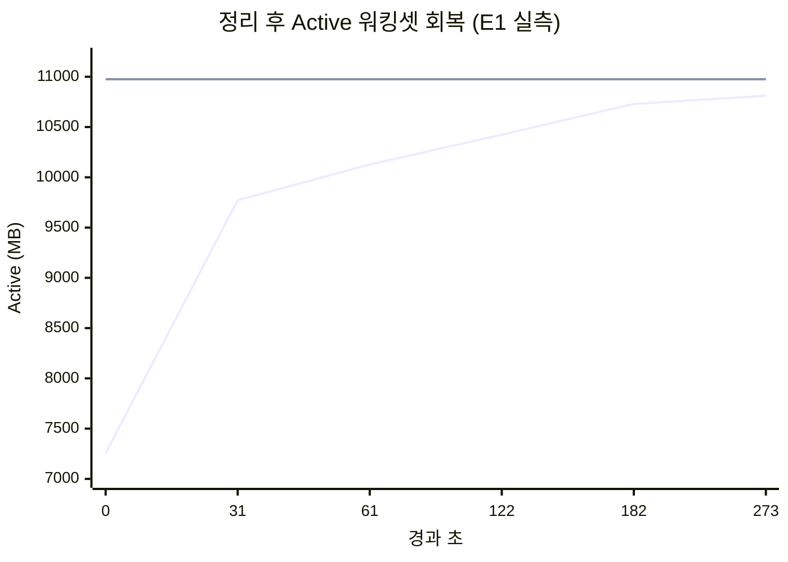

# 21 · 메모리 정리의 효용성 — 실측 검증

> **질문(사용자, 2026-08-07)**: "이 프로그램을 실행하고 주기적으로 메모리 정리를 하는 동작이
> 실제로 성능 향상에 도움이 되는가?"
>
> 이 문서는 그 질문에 **실측으로** 답한다. 기준을 먼저 선언하고([§2](#2-판정-기준--측정-전에-선언한다)),
> 통제된 실험 5종을 돌려([§3](#3-측정-환경과-방법)), 결과를 축별로 판정한다.
> 원리 해설은 [19](19-memory-measurement-and-reclaim.md), 결정은 [10](10-decision-record.md).

---

## 1. 한 문단 요약

**여유가 있는 평상시에 주기적으로 정리하는 것은 성능에 도움이 되지 않는다.** 정리는 실제로
워킹셋 3.9GB를 걷어냈지만 **그 절반이 14초 만에, 96%가 4분 만에 되돌아왔다** — 프로세스들이
그 페이지를 실제로 쓰고 있었기 때문이다. 메모리가 빠듯할 때 미리 정리해두는 것도 도움이 되지
않았다(4GB 할당 소요 1,032ms → 1,020ms, 라운드 간 편차보다 작은 차이). 반면 대가는 측정된다 —
1.2GB 워킹셋을 되찾는 데 **약 0.4초**, 정리 직후 앱 기동 **+10.7%**, 디스크 읽기량 **3.7배**.
공격적 영역 ③을 켜면 파일 읽기가 **4.4배** 느려진다. **결론: 이 도구의 가치는 "주기적 정리"가
아니라 관찰(목록·Top 5·종료)과 특정 순간의 온디맨드 정리에 있다.** 기본 설정이 이미 그렇게
되어 있고([§9](#9-판정과-권고)), 이 측정은 그 기본값이 옳았음을 뒷받침한다.

---

## 2. 판정 기준 — 측정 전에 선언한다

### 2-1. 왜 "회수 MB"는 기준이 될 수 없나

알림에 뜨는 `+NNN MB`는 `AvailAfter − AvailBefore`다([19 §4-3](19-memory-measurement-and-reclaim.md)).
그런데 `Available = Free + Zeroed + Standby`이므로, ① 트림이 페이지를 **Active에서 Standby로
옮기기만 해도** 이 숫자는 올라간다. **숫자가 올랐다 ≠ 빨라졌다.**

실측이 이 괴리를 그대로 보여준다 — 같은 정리 1회에서:

| 보고된 회수량 | 실제 Active 감소 | Modified로 밀려난 양 |
| --- | --- | --- |
| **+679 MB** | **−3,870 MB** | **+3,195 MB** |

Active가 3.9GB 줄었는데 표시는 679MB뿐이다. 나머지는 더티 페이지라 Modified 목록으로 갔고,
Modified는 Available에 포함되지 않기 때문이다. **표시값은 실제 일어난 일의 1/5도 설명하지 못한다.**

> ✅ **반영(E-1, 08-08)**: 알림이 두 숫자를 함께 보여 준다 — `935MB reclaimed · apps released 5519MB`
> (실행 실측). Active 감소분이 표시값보다 뚜렷하게 클 때만 병기해, 비슷할 때는 숫자를 늘어놓지 않는다.

### 2-2. 4축 기준

| 축 | 질문 | 지표 | "도움 됨" 판정선 |
| --- | --- | --- | --- |
| **A 효과** | 재사용 가능한 메모리가 실제로 늘었나 | `Active = Total − Avail − Modified` 감소분 | 유의미한 Active 감소 |
| **B 지속성** | 그 효과가 유지되나 | Active 회복 곡선의 **반감기** | 반감기 > 정리 주기 |
| **C 대가** | 되돌리는 데 무엇을 지불하나 | 소프트/하드 폴트, 디스크 읽기·쓰기 MB, 재접근 지연 | 하드 폴트·디스크 I/O 증가 없음 |
| **D 순효과** | 실제 작업이 빨라지나 | 앱 기동 지연, 파일 읽기 시간, 대용량 할당 처리량 | 무정리 대비 유의미한 개선 |

### 2-3. 판정 규칙 (결과를 보고 기준을 바꾸지 않기 위해 먼저 못 박음)

- **D 개선 없음 + C 비용 있음** → 그 조건에서 정리는 **손해**
- **D 개선 없음 + C 비용 없음** → **중립**(플라세보). 주기 정리를 권할 근거 없음
- **D 개선 + C 감당 가능** → **이득**. 단, 어떤 압력 조건에서인지 반드시 명시
- 결과는 **압력 수준별로 분리** 보고한다(여유 있을 때 / 빠듯할 때)

---

## 3. 측정 환경과 방법

### 3-1. 시험대 (2026-08-07 23시대, 단일 머신)

| 항목 | 값 | 왜 중요한가 |
| --- | --- | --- |
| 물리 RAM | **16,085 MB** | |
| 커밋 | **26,032 MB** / 한도 35,541 | 물리 RAM을 **10GB 초과** — 이미 압력 상태 |
| Free 페이지 | **2.5 MB** | 사실상 0. 여유 = 전부 Standby 캐시 |
| 페이지 파일 | **D:\pagefile.sys (19.4GB)** | **D: = WDC WD10SPZX 기계식 HDD** |
| 시스템 디스크 | C: = SSSTC CL4-8D256 **SSD** | |
| CPU | 12 논리 코어 | |
| OS | Windows 11 Pro 26200 | |

> ⚠️ **페이지 파일이 HDD에 있다** — 하드 폴트 1회가 SSD 대비 수~수십 배 비싸다.
> 즉 이 시험대는 **정리에 유리한 조건**이다(페이징을 피할 수 있다면 이득이 클 환경).
> 그런데도 이득이 나오지 않았다면 결론은 더 강해진다.

### 3-2. 통제

- 상주 셸을 **중지**하고 워커를 직접 호출(`NexaMemKeeper.exe --worker clean`) — 자동 정리
  (임계 90%·저메모리 이벤트)가 대조군에 섞이지 않게. 표본 직전마다 셸 부활 여부를 확인·차단.
- 조건 간 **교차 반복**(NOCLEAN/CLEAN 번갈아)으로 시간 드리프트 상쇄.
- 계측은 로케일 무관한 `Win32_PerfRawData_PerfOS_Memory` 누적 카운터 **차분**.
  Available·Free·Modified·Standby(우선순위 0 / 1~7)·Committed + 하드 폴트·소프트 폴트·
  디스크 읽기(PagesInput)·디스크 쓰기(PagesOutput).
- 정리 영역은 **기본값 ①+②**(워킹셋 트림 + 우선순위 0 스탠바이 퍼지). ③은 E4에서만 별도 비교.

### 3-3. 실험 목록

| # | 무엇을 보나 | 설계 |
| --- | --- | --- |
| **E1** | 효과·출처·지속성 | 무정리 기준선 90초 → 정리 1회 → 사후 300초 5초 간격 추적 |
| **E3** | 되돌리는 직접 비용 | 통제 워크로드 1,200MB를 만들고 정상/트림 직후/정리 직후 재접근 시간 비교 |
| **E4** | 체감 지연 | 앱 기동 8회 + 파일 코퍼스 196.8MB 읽기 — 정상 / 기본정리 / 공격적정리(③) |
| **E5** | 압력 하 유효성 | 4GB 할당·터치를 [무정리] / [직전 정리] 교차 3라운드 |
| **E6** | **주기적** 정리의 순효과 | 5분 블록 4개를 [무정리] / [60초마다 정리] 교대, 60초마다 동일 벤치마크 |

---

## 4. E1 — 효과는 크지만 **반감기가 14초**다

### 4-1. 정리 순간에 일어난 일

정리 1회(468개 프로세스 트림, wall 841ms · CPU 688ms):

| | 정리 직전 | 정리 직후 | 변화 |
| --- | --- | --- | --- |
| Active(실사용 워킹셋) | 11,025 MB | **7,155 MB** | **−3,870 MB** |
| Modified(더티, 쓰기 대기) | 169 MB | **3,364 MB** | **+3,195 MB** |
| Available | 4,891 MB | 5,566 MB | +675 MB |
| 소프트 폴트 | — | — | **123,471건 / 0.84초** |

효과 자체는 진짜다 — 워킹셋 3.9GB가 실제로 걷혔다. 문제는 그다음이다.

### 4-2. 회복 곡선 — 프로세스가 곧바로 되찾아간다

> 아래는 **5초 간격 시계열**이라 §4-1의 정밀 스냅샷과 표본 시각이 다르다. 이 계열 기준
> 정리 직전 Active는 10,976MB, 최저점은 7,256MB이며 **낙폭 3,720MB**를 100%로 회복률을 계산했다.

| 경과 | Active(MB) | Modified(MB) | 낙폭 회복률 |
| --- | --- | --- | --- |
| 0초 | 7,256 | 3,266 | 0% |
| **14초** | ≈9,100 | ≈400 | **50%** ← 반감기 |
| 31초 | 9,772 | 117 | 68% |
| 61초 | 10,127 | 96 | 77% |
| 122초 | 10,424 | 123 | 85% |
| 182초 | 10,730 | 109 | 93% |
| **273초** | **10,812** | 128 | **96%** |

> 위 선 = 실측 Active, 아래 기준선 = 정리 직전 수준(10,976MB). **4분 만에 원위치로 수렴한다.**

프로세스별로 보면 더 분명하다:

| 프로세스 | 정리 전 | 정리 직후 | +5분 |
| --- | --- | --- | --- |
| **Code**(VS Code) | 666.7 MB | **39.6 MB** | **716.8 MB** |
| claude | 270.1 MB | 47.7 MB | 223.2 MB |
| Memory Compression | 1,653.6 MB | 1,669.9 MB | 1,842.6 MB |

VS Code는 667MB → 40MB로 깎였다가 **정리 전보다 큰 717MB로 복귀**했다. 메모리 사용량이 줄어든
것이 아니라 **다시 읽어들이도록 강요당한 것**이다. Memory Compression만 189MB 늘었는데, 트림된
페이지 일부가 압축 저장소로 들어갔다는 뜻이다(그 자체가 CPU 비용).

### 4-3. 사후 300초의 대가

| 지표 | 무정리 기준선(90초) | 정리 후(300초) | 판정 |
| --- | --- | --- | --- |
| 하드 폴트율 | 17.6 회/초 | **17.8 회/초** | 사실상 동일 ✅ |
| 디스크 읽기량 | 0.36 MB/초 | **1.33 MB/초** | **3.7배** ⚠️ |
| 페이지파일 쓰기 | 0 MB | **42.9 MB** | 새로 발생 ⚠️ |
| 소프트 폴트율 | 11,064 회/초 | 9,709 회/초 | 증가 없음 ✅ |

Modified로 밀려난 3.1GB 중 **디스크로 실제 나간 것은 43MB뿐**이다. 나머지는 프로세스들이
쓰기 전에 소프트 폴트로 되찾아갔다. HDD 쓰기 폭증까지는 가지 않았다는 뜻이고, 이는 ① 트림이
"안전하다"는 [19 §4-1](19-memory-measurement-and-reclaim.md)의 주장을 뒷받침한다.
**다만 안전한 것과 이득인 것은 다르다.**

---

## 5. E3 — 되찾는 데 드는 시간: **GB당 약 0.35초**

통제 워크로드 1,200MB(터치 완료 상태)를 두고 재접근 시간을 쟀다.

| 상태 | 재접근 소요 | 처리량 | 소프트 폴트 | 하드 폴트 |
| --- | --- | --- | --- | --- |
| 정상(워킹셋 살아 있음) | **42.6~72.7 ms** | 16.5~28.2 GB/s | ~320 | 0 |
| **표적 트림 직후** | **413.7 ms** | 2.9 GB/s | **311,293** | **0** |
| 트림 후 재정착 | 28.0 ms | 42.8 GB/s | 709 | 0 |
| **전체 정리 직후** | **572.4 ms** | 2.1 GB/s | **408,869** | 76 |
| 정리 + 60초 방치 후 | **459.2 ms** | 2.6 GB/s | 313,372 | **1** |

**읽는 법**

- 트림당한 프로세스가 1.2GB를 되찾는 데 **약 0.4초**가 더 든다(43ms → 414ms, 약 10배).
  페이지 하나당은 μs지만 1.2GB = 30만 페이지라 **합계가 0.4초**가 된다.
  [19](19-memory-measurement-and-reclaim.md)의 "소프트 폴트 ~μs라 안전"은 맞지만 **공짜는 아니다**.
- 하드 폴트는 **0~1건** — 디스크는 쓰지 않았다. 60초를 방치한 뒤에도 마찬가지였다(하드 폴트 1건).
  즉 페이지는 RAM(Standby/Modified)에 남아 있었고 되돌림은 전부 메모리 내 이동이었다.
- 되찾은 다음 회차는 다시 28~31ms로 정상 복귀 — **비용은 1회성**이다.

> 📌 정리 = **되찾을 때 GB당 0.35초를 내는 대신 그 시간 동안 메모리를 빌려주는 거래**다.
> 빌려간 쪽이 그 메모리를 실제로 쓴다면 이득이지만, E1에서 봤듯 대개는 **원래 주인이 곧바로 되찾아간다**.

---

## 6. E4 — 체감 지연: 기본값은 미미, ③은 명백한 손해

앱 기동(pwsh, 8회) + 파일 코퍼스 읽기(System32 DLL 400개 = 196.8MB).

| 조건 | 기동 중앙값 | 기동 평균 | 기동 최댓값 | 코퍼스 읽기 | 읽기 처리량 | 하드 폴트 | 디스크 읽기 |
| --- | --- | --- | --- | --- | --- | --- | --- |
| **A** 정상(캐시 따뜻함) | 328.2 ms | 327.8 ms | 348.0 ms | **60.5 ms** | 3,254 MB/s | 5 | 0.1 MB |
| **B** 기본 정리(①②) 직후 | **363.4 ms** | 366.8 ms | 452.3 ms | 64.3 ms | 3,060 MB/s | 83 | 1.7 MB |
| **C** 공격적 정리(①②③) 직후 | 347.8 ms | 385.1 ms | **662.4 ms** | **265.4 ms** | 741 MB/s | **9,131** | **452.8 MB** |
| **D** 회복 후(재캐시) | 347.3 ms | 341.7 ms | 357.5 ms | 81.7 ms | 2,408 MB/s | 1,650 | 43.1 MB |

**판정**

- **기본값(①②)은 체감 영향이 작다** — 앱 기동 +35ms(**+10.7%**), 파일 읽기 +6%, 디스크 읽기 1.7MB.
  체감할 수 있는 수준은 아니지만 **방향은 명확히 마이너스**다. 개선은 어느 항목에서도 없었다.
- **③ 전체 스탠바이 퍼지는 파일 캐시를 실제로 전멸시킨다** — 같은 196.8MB를 읽는 데
  60.5ms → **265.4ms(4.4배)**, 디스크에서 **452.8MB를 다시 읽었다**. 기동 최댓값도 662ms로 튀었다.
  게다가 회수량은 오히려 가장 적었다(+215MB).
- **③을 기본 off로 둔 [DR/ADR-0002](07-adr-0002-memory-reclaim.md)의 결정이 실측으로 정당화된다.**
  "가용 숫자는 커 보이지만 실제 가치는 낮다"는 [19 §4-3](19-memory-measurement-and-reclaim.md)의
  경고가 정확했다.

---

## 7. E5 — 압력 하에서 미리 정리해두면? **차이 없음**

4GB를 한꺼번에 할당·터치하는 워크로드를, 직전에 정리한 경우와 안 한 경우로 교차 3라운드.

| 조건 | 할당 소요(평균) | 할당 처리량 | 2회차 재터치 | 하드 폴트 | 디스크 쓰기 |
| --- | --- | --- | --- | --- | --- |
| **NOCLEAN** | 1,032.2 ms | 3,984 MB/s | 483.8 ms | 29 | 24.1 MB |
| **CLEAN**(직전 정리) | **1,019.8 ms** | 4,023 MB/s | 452.8 ms | 12 | 3.3 MB |
| 차이 | **−12.4 ms (−1.2%)** | +1.0% | −6.4% | — | — |

라운드별 원값은 NOCLEAN이 949~1,103ms, CLEAN이 980~1,076ms로 **조건 간 차이(12ms)보다
라운드 간 편차(154ms)가 12배 크다**. 즉 **통계적으로 의미 없는 차이**다.

**왜 차이가 없나** — Windows는 대용량 할당이 들어오면 Standby 목록에서 즉시 가져다 쓴다.
Standby는 이미 "재사용 가능"이므로 **미리 Free로 만들어 둘 필요가 없다**. 정리는 OS가 어차피
필요할 때 공짜로 하는 일을, 미리 비용을 치르고 해두는 것에 가깝다.

디스크 쓰기가 CLEAN에서 적게 나온 것(24.1 → 3.3MB)은 방향이 유리하지만 절대량이 작아
성능 차이로 이어지지 않았고, 표본 3개로는 단정할 수 없다.

---

## 8. E6 — **주기적** 정리의 순효과: 숫자는 오르고 속도는 내린다

질문 그대로의 실험이다. 5분 블록 4개를 **[무정리] / [60초마다 정리]**로 교대하고, 각 블록에서
60초마다 **동일한 벤치마크**(앱 기동 3회 + 코퍼스 76.5MB 읽기)를 돌렸다. 조건당 표본 10개.

### 8-1. 성능 지표 — 전 항목에서 주기 정리가 더 느리다

| 지표 | 무정리(CONTROL) | **60초마다 정리(PERIODIC)** | 차이 |
| --- | --- | --- | --- |
| 앱 기동 중앙값 | **316.1 ms** | 329.6 ms | **+4.3% 느림** |
| 앱 기동 평균 | **315.4 ms** | 328.9 ms | +4.3% 느림 |
| 코퍼스 읽기 중앙값 | **26.1 ms** | 29.4 ms | **+12.6% 느림** |
| 코퍼스 읽기 평균 | **26.7 ms** | 42.8 ms | **+60% 느림** |
| 벤치마크 중 하드 폴트 합 | **26** | **620** | **24배** |

### 8-2. 메모리 지표 — 겉보기 숫자는 확실히 좋아진다

| 지표 | 무정리 | 60초마다 정리 | 차이 |
| --- | --- | --- | --- |
| Available 평균 | 6,801 MB | **7,489 MB** | **+688 MB** |
| Active 평균 | 9,155 MB | **7,461 MB** | **−1,694 MB** |

### 8-3. 10분간 치른 비용

| 항목 | 무정리(블록 1+3) | 60초마다 정리(블록 2+4) |
| --- | --- | --- |
| 소프트 폴트 | 2,267,474 | **8,869,124** (3.9배) |
| 디스크 읽기 | 160.9 MB | **948.9 MB** (5.9배) |
| 디스크 쓰기(페이지파일) | **0 MB** | **100.3 MB** |
| 정리에 쓴 CPU 시간 | 0 | **6.1초** (10회 × ~0.6초) |

> ⚠️ 블록 합계는 벤치마크 외 배경 활동까지 포함해 편차가 크다(블록 4의 하드 폴트 32,386건은
> 이상치). 조건 간 **통제된 비교는 §8-1의 벤치마크 구간 값**이며, 블록 합계는 규모 감각용으로만 읽는다.

### 8-4. 판정

**주기적 정리는 `Available` 숫자를 688MB 올리는 대가로 앱 기동을 4.3%, 파일 읽기를 12.6% 느리게
만들었다.** 개선된 성능 지표는 **하나도 없었다.** 이것이 전형적인 플라세보 패턴이다 — 도구가
보여주는 숫자는 좋아지고, 사용자가 실제로 느끼는 것은 조금씩 나빠진다.

---

## 9. 판정과 권고

### 9-1. 4축 종합

| 축 | 결과 | 판정 |
| --- | --- | --- |
| **A 효과** | Active −3,870 MB (468 프로세스 트림) | ✅ 효과는 진짜다 |
| **B 지속성** | **반감기 14초**, 4분이면 96% 원위치 | ❌ 어떤 주기 설정보다 짧다 |
| **C 대가** | 되찾기 GB당 0.35초 · 기동 +10.7% · 디스크 읽기 3.7배 · 페이지파일 쓰기 신규 발생 | ⚠️ 작지만 실재한다 |
| **D 순효과** | 압력 하 할당 차이 −1.2%(무의미) · 주기 정리 시 전 항목 악화 | ❌ 개선 없음 |

**[§2-3](#2-3-판정-규칙-결과를-보고-기준을-바꾸지-않기-위해-먼저-못-박음)의 규칙 적용:
D 개선 없음 + C 비용 있음 → 이 시험대의 압력 범위에서 주기적 정리는 "손해"다.**

핵심 인과는 단순하다. **정리가 걷어낸 워킹셋은 프로세스들이 실제로 쓰던 페이지였다.**
그래서 곧바로 되찾아간다(VS Code 667MB → 40MB → 717MB). 도구는 메모리 **수요**를 줄이지 못하고,
같은 페이지를 다시 읽어들이는 **작업만 추가**한다. 그리고 Windows는 압력이 실제로 생기면
그때 알아서 트림하므로, 미리 해둘 이유도 없다(E5).

### 9-2. 제품 권고

| # | 권고 | 근거 |
| --- | --- | --- |
| 1 | **`interval_ms` 기본 0(주기 정리 off) 유지** — 설정 창·문서에 "권장하지 않음"과 근거(반감기 14초)를 명시 | E6·E1 |
| 2 | **영역 ③④⑤ 기본 off 유지** — ③은 파일 읽기 4.4배 악화, 회수량은 오히려 최소 | E4 |
| 3 | **알림 회수량에 `Active` 감소분을 함께 표기** — 현재 표시(Available 차)는 실제로 일어난 일의 **1/5에 못 미친다**(+679MB vs Active −3,870MB) | E1 §2-1 |
| 4 | **임계값 90% + 저메모리 이벤트 조합 유지** — 이 PC는 평상시 68~77%라 임계값에 거의 닿지 않는다. 즉 실질 트리거는 OS의 저메모리 알림이고, 이는 "필요할 때만 움직인다"는 올바른 설계다 | E1·E6 |
| 5 | **홍보 문구에서 "성능 향상"을 약속하지 않는다** — 현재 [README](../README.md)·[00 비전](00-vision.md)은 도구 자신의 경량성만 주장하고 있어 정정할 내용은 없다. 이 상태를 유지한다 | 본 문서 |

### 9-3. 그럼 이 도구는 쓸모가 없나 — 아니다, 가치가 다른 곳에 있다

- **관찰이 본체다** — 작업 관리자식 목록·Top 5·프로세스 트리·검색·선택 종료. 무엇이 메모리를
  먹는지 **정확한 기준(프라이빗 워킹셋)으로 보여주는 것**은 이 측정과 무관하게 유효하다.
- **온디맨드 정리는 "필요할 때 손으로"** — 무거운 앱을 닫은 직후처럼 회수가 실제로 남을 만한
  순간에 1회. 자동·주기가 아니라 사용자가 판단하는 도구로 둔다.
- **자신이 가볍다는 정체성은 그대로다** — 유휴 RSS 1.30MB · exe 0.64MB([DR-8](10-decision-record.md)).
  효용이 중립인 기능이라도 **비용이 0에 가까우면 해롭지 않다**는 점이 이 설계의 방어선이다.

---

## 10. 한계 — 이 결론이 닿지 않는 곳

1. **단일 머신·단일 세션(약 90분)** — 16GB RAM, 페이지파일이 HDD. 다른 구성(32GB, NVMe 페이지파일,
   RAM이 정말 부족한 8GB 기기)에서는 다를 수 있다.
2. **진짜 고압력 구간은 만들지 못했다** — 측정 중 Available은 4.6~7.7GB 범위였다.
   Available이 수백 MB로 떨어져 실제 스래싱이 일어나는 구간은 검증하지 못했다.
   그 구간에서는 결론이 달라질 여지가 있다(다만 Windows가 그때는 스스로 트림한다).
3. **합성 워크로드** — 앱 기동(pwsh)·DLL 코퍼스 읽기·대용량 할당. 실제 사용 체감
   (게임 프레임 타임, 편집기 반응성)과 정확히 같지 않다.
4. **정리 반복이 시험대 자체를 바꿨다** — 90분간 20여 회 정리하면서 Available이 3.7GB에서
   7.5GB로 드리프트했다. 후반 실험일수록 압력이 낮은 조건에서 측정된 셈이다.

> 🔁 **재현**: 측정 스크립트는 `scripts/measure/`에 있다. `pwsh scripts\measure\e6_periodic.ps1`처럼
> 개별 실행하며, 각 스크립트는 시작 시 상주 셸을 중지하고 CSV를 남긴다.
